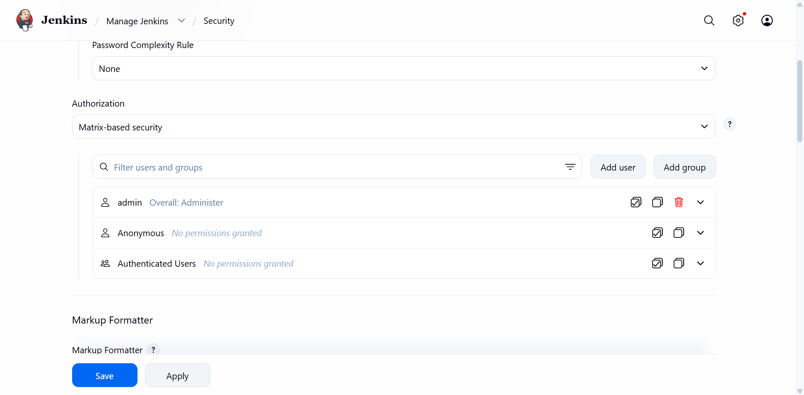
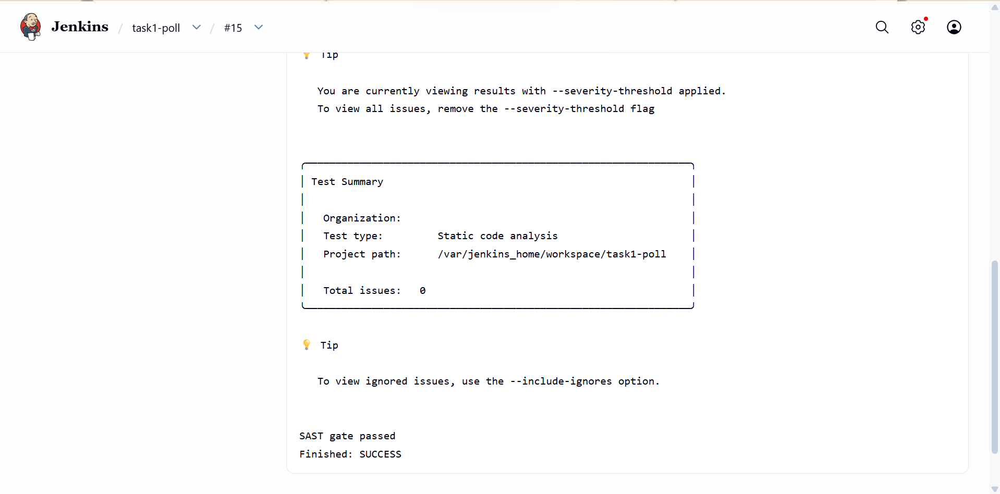
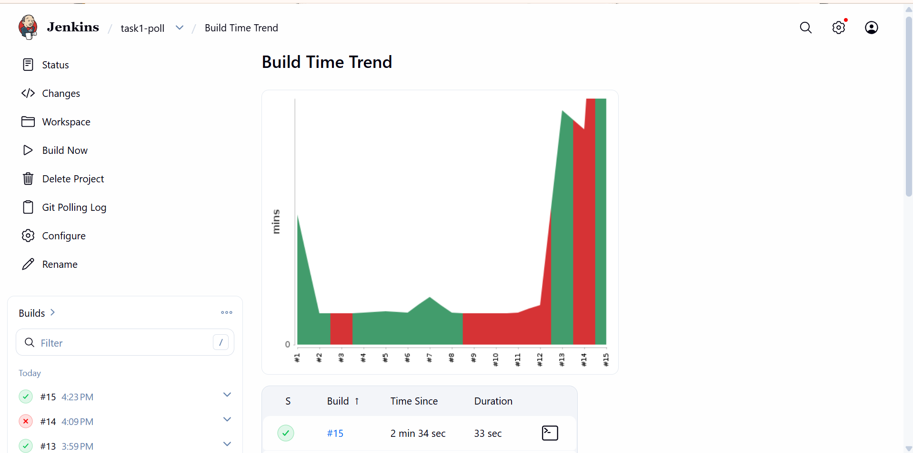

# Barakah TechLabs DevOps Internship

AWS DevOps & CI/CD Pipeline Engineer internship tasks by Arslan Asad Qazi.

All tasks build on one small Flask app, so each task adds a new stage to the same pipeline.

| Task | Tag |
|---|---|
| Task 1: Jenkins Server Setup via Docker | `task-1-jenkins` |
| Task 2: Code Quality & Security Scanning (SAST) | `task-2-sast` |

---

## Task 1: Jenkins Server Setup via Docker

**Goal:** Run Jenkins in Docker, install plugins, secure the admin panel, and create a Freestyle job that runs a shell script when it polls the repo and finds a new commit.

### Setup

- **Host:** AWS EC2, Ubuntu 24.04
- **Jenkins:** official `jenkins/jenkins:lts-jdk21` image, extended with Python in [`jenkins/Dockerfile`](jenkins/Dockerfile)
- **Run script:** [`jenkins/run.sh`](jenkins/run.sh) builds the image and starts the container with a restart policy and a named volume, so jobs and settings survive restarts
- **Java 21:** Jenkins LTS dropped Java 17 in 2026, so the JDK 21 image keeps Jenkins on a supported, patched version

To run it on a fresh Docker host:

```bash
git clone https://github.com/arsalqazi3/Barakah-DevOps-Internship.git
cd Barakah-DevOps-Internship
bash jenkins/run.sh
```

### Plugins

Installed the suggested plugins from the setup wizard, mainly Git (to pull the repo), Credentials and Matrix Authorization Strategy (for permissions). All plugins were updated after setup.


### Securing the admin panel

Jenkins can run any code on its server, so an open Jenkins is a common target. I used several layers:

- **Network:** the EC2 security group only allows port 8080 and SSH from my own IP. The rest of the internet can't reach Jenkins at all.
- **No public sign-up:** "Allow users to sign up" is turned off.
- **Matrix-based security:** only my admin account has permissions. Anonymous users get nothing, so they only see the login page.
- **Agent port disabled:** no inbound agents are used, so that port stays closed.
- **CSRF protection:** left on (default).



**Known trade-off:** Jenkins runs on plain HTTP here, so the login isn't encrypted in transit. For production I'd put it behind HTTPS (a reverse proxy with a certificate) or reach it only through an SSH tunnel.

### Freestyle job with Poll SCM

Job `task1-poll`:

- **Source:** this repo, branch `main`
- **Trigger:** Poll SCM, schedule `H/2 * * * *` (checks for new commits every 2 minutes)
- **Build step:** `bash ci.sh`

[`ci.sh`](ci.sh) creates a clean Python environment, installs the requirements and runs the unit tests. It uses `set -euo pipefail`, so any failing test fails the build.

The job's config is saved in [`jenkins/jobs/task1-poll/config.xml`](jenkins/jobs/task1-poll/config.xml), so it can be reviewed and recreated.

### Proof it works

**1. A push starts a build by itself:**


**2. A broken test fails the build:**


**3. Reverting the change makes it pass again:**


### Why polling and not a webhook?

The task asks for a repository poll. Polling also works without opening Jenkins to GitHub, since Jenkins reaches out and nothing has to come in. In production, a webhook is usually better because it reacts at once and doesn't keep asking GitHub.

### AI Edge: declarative vs scripted pipelines

Both are written in a `Jenkinsfile` kept in the repo (pipeline as code). Freestyle jobs like this one are set up by clicking in the UI instead, which is why they're seen as legacy.

- **Declarative:** a fixed structure, `pipeline { agent ... stages { stage(...) { steps { ... } } } }`. Jenkins checks the syntax before running, and it has built-in blocks like `post`, `options` and `when`. Easy to read and the usual choice today.
- **Scripted:** plain Groovy inside `node { stage(...) { ... } }`. It allows full programming logic like loops and complex conditions, but it's harder to read and easier to get wrong.

Short version: declarative for most pipelines, scripted only when you need logic the declarative format can't express (and even then, a `script { }` block inside a declarative pipeline is often enough).

---

## Task 2: Code Quality & Security Scanning (SAST)

**Goal:** Add a SAST scan to the CI pipeline that finds security bugs like exposed secrets and SQL injection, and fails the build when it finds them.

### Tool choice: Snyk Code

The task allows SonarQube or Snyk. I picked **Snyk Code** because:

- The free SonarQube Community Build doesn't do taint analysis, so it can't trace user input into a SQL query. That needs the paid Developer Edition. Snyk Code's free plan catches SQL injection and hardcoded secrets in Python.
- It's a CLI, so there's no extra server to run next to Jenkins.

### How it's wired in

- **Snyk CLI** is baked into the Jenkins image in [`jenkins/Dockerfile`](jenkins/Dockerfile), so it stays installed when the container is recreated.
- **Snyk token** is stored in Jenkins Credentials as secret text (ID `synk-token`) and passed to the job as the `SNYK_TOKEN` environment variable. It's never in the repo, and Jenkins masks it in logs.
- **SAST stage** in `task1-poll`: the Execute shell step now runs `bash sast.sh` right after `bash ci.sh`
- [`sast.sh`](sast.sh) runs `snyk code test --severity-threshold=medium`. Any Medium, High or Critical finding makes the command exit non-zero, which fails the build. That's the **security gate**.

Pipeline now: **poll GitHub → checkout → unit tests → SAST gate**

### Proof it works

To prove the gate, I added two bugs on purpose: a hardcoded Flask secret key and a `/users` endpoint that builds its SQL query from user input.

**1. Unit tests still passed, but Snyk caught both bugs as HIGH:**


**2. The gate failed the build:**


**3. After fixing the code, the scan found 0 issues and the build passed:**



**4. Build history: clean (#13), vulnerable (#14), fixed (#15):**



This is the point of shift-left security: the tests said the code *works*, only the SAST stage said it was *unsafe*, and it was stopped before it could ever be deployed.

**Fail closed:** during a Snyk maintenance window the scan couldn't run, and the build failed instead of passing. For a security gate that's the right behaviour, since a scan that didn't run shouldn't count as a pass.

### AI Edge: analyzing a finding and fixing it

**Finding:** `[HIGH] SQL Injection`, `app.py` line 29
> Unsanitized input from an HTTP parameter flows into execute, where it is used in an SQL query.

**What was wrong:**

```python
name = request.args.get("name", "")
query = f"SELECT id, name FROM users WHERE name = '{name}'"
rows = conn.execute(query).fetchall()
```

The `name` parameter was pasted straight into the SQL string. A request like `/users?name=' OR '1'='1` turns the query into `... WHERE name = '' OR '1'='1'`, which is always true, so it returns every user. With other inputs an attacker could read other tables or change data.

**Fix: parameterized query**

```python
rows = conn.execute(
    "SELECT id, name FROM users WHERE name = ?", (name,)
).fetchall()
```

The `?` placeholder sends the input to the database separately from the SQL, as plain data. It can never change the structure of the query, so `' OR '1'='1` is just searched for as a (strange) name. Other good habits: validate input, and give the app's database user only the permissions it needs.

**Second finding:** `[HIGH] Hardcoded Non-Cryptographic Secret`, `app.py` line 8. The Flask secret key was a fixed string in the code, so anyone who could read the repo could forge session cookies. Fixed by reading it from the `SECRET_KEY` environment variable, with a random key generated at startup if it isn't set:

```python
app.config["SECRET_KEY"] = os.environ.get("SECRET_KEY") or secrets.token_hex(32)
```

In production the real key would come from a secret manager such as AWS Secrets Manager, and a secret that was ever committed should be rotated, since it stays in Git history.
