# Barakah TechLabs DevOps Internship

AWS DevOps & CI/CD Pipeline Engineer internship tasks by Arslan Asad Qazi.

All tasks build on one small Flask app, so each task adds a new stage to the same pipeline.

| Task | Tag |
|---|---|
| Task 1: Jenkins Server Setup via Docker | `task-1-jenkins` |
| Task 2: Code Quality & Security Scanning (SAST) | `task-2-sast` |
| Task 3: Docker Image CI/CD to ECR | `task-3-ecr` |
| Task 6: Automated Container Deployment to ECS | `task-6-ecs` |

---

## Task 1: Jenkins Server Setup via Docker

**Goal:** Run Jenkins in Docker, install plugins, secure the admin panel, and create a Freestyle job that runs a shell script when it polls the repo and finds a new commit.

### Setup

- **Host:** AWS EC2, Ubuntu 24.04
- **Jenkins:** official `jenkins/jenkins:lts-jdk21` image, extended with Python in [`jenkins/Dockerfile`](jenkins/Dockerfile)
- **Run script:** [`jenkins/run.sh`](jenkins/run.sh) builds the image and starts the container with a restart policy and a named volume, so jobs and settings survive restarts
- **Java 21:** Jenkins LTS dropped Java 17 in 2026, so the JDK 21 image keeps Jenkins on a supported, patched version

To run it on a fresh Docker host:

```bash
git clone https://github.com/arsalqazi3/Barakah-DevOps-Internship.git
cd Barakah-DevOps-Internship
bash jenkins/run.sh
```

### Plugins

Installed the suggested plugins from the setup wizard, mainly Git (to pull the repo), Credentials and Matrix Authorization Strategy (for permissions). All plugins were updated after setup.


### Securing the admin panel

Jenkins can run any code on its server, so an open Jenkins is a common target. I used several layers:

- **Network:** the EC2 security group only allows port 8080 and SSH from my own IP. The rest of the internet can't reach Jenkins at all.
- **No public sign-up:** "Allow users to sign up" is turned off.
- **Matrix-based security:** only my admin account has permissions. Anonymous users get nothing, so they only see the login page.
- **Agent port disabled:** no inbound agents are used, so that port stays closed.
- **CSRF protection:** left on (default).


**Known trade-off:** Jenkins runs on plain HTTP here, so the login isn't encrypted in transit. For production I'd put it behind HTTPS (a reverse proxy with a certificate) or reach it only through an SSH tunnel.

### Freestyle job with Poll SCM

Job `task1-poll`:

- **Source:** this repo, branch `main`
- **Trigger:** Poll SCM, schedule `H/2 * * * *` (checks for new commits every 2 minutes)
- **Build step:** `bash ci.sh`

[`ci.sh`](ci.sh) creates a clean Python environment, installs the requirements and runs the unit tests. It uses `set -euo pipefail`, so any failing test fails the build.

The job's config is saved in [`jenkins/jobs/task1-poll/config.xml`](jenkins/jobs/task1-poll/config.xml), so it can be reviewed and recreated.

### Proof it works

**1. A push starts a build by itself:**

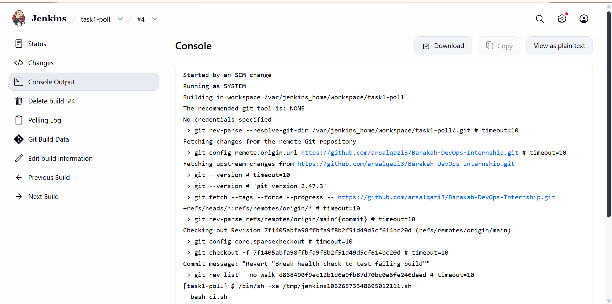

**2. A broken test fails the build:**

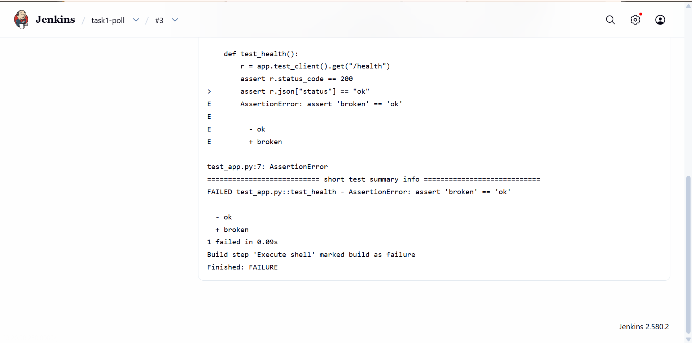

**3. Reverting the change makes it pass again:**

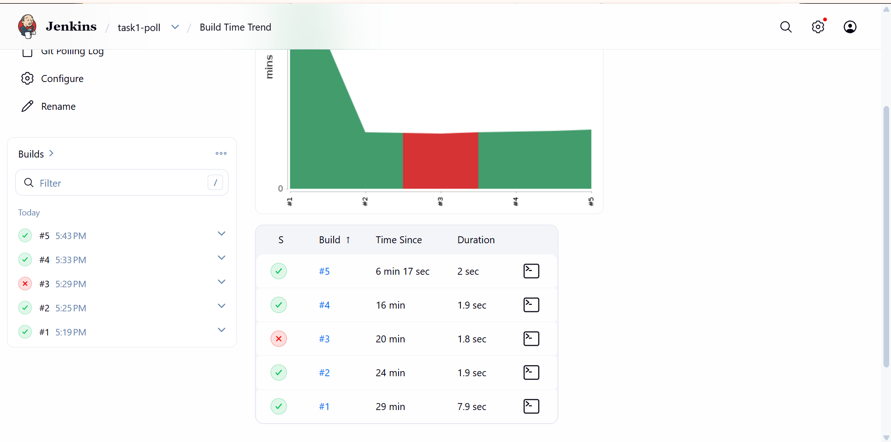

### Why polling and not a webhook?

The task asks for a repository poll. Polling also works without opening Jenkins to GitHub, since Jenkins reaches out and nothing has to come in. In production, a webhook is usually better because it reacts at once and doesn't keep asking GitHub.

### AI Edge: declarative vs scripted pipelines

Both are written in a `Jenkinsfile` kept in the repo (pipeline as code). Freestyle jobs like this one are set up by clicking in the UI instead, which is why they're seen as legacy.

- **Declarative:** a fixed structure, `pipeline { agent ... stages { stage(...) { steps { ... } } } }`. Jenkins checks the syntax before running, and it has built-in blocks like `post`, `options` and `when`. Easy to read and the usual choice today.
- **Scripted:** plain Groovy inside `node { stage(...) { ... } }`. It allows full programming logic like loops and complex conditions, but it's harder to read and easier to get wrong.

Short version: declarative for most pipelines, scripted only when you need logic the declarative format can't express (and even then, a `script { }` block inside a declarative pipeline is often enough).

---

## Task 2: Code Quality & Security Scanning (SAST)

**Goal:** Add a SAST scan to the CI pipeline that finds security bugs like exposed secrets and SQL injection, and fails the build when it finds them.

### Tool choice: Snyk Code

The task allows SonarQube or Snyk. I picked **Snyk Code** because:

- The free SonarQube Community Build doesn't do taint analysis, so it can't trace user input into a SQL query. That needs the paid Developer Edition. Snyk Code's free plan catches SQL injection and hardcoded secrets in Python.
- It's a CLI, so there's no extra server to run next to Jenkins.

### How it's wired in

- **Snyk CLI** is baked into the Jenkins image in [`jenkins/Dockerfile`](jenkins/Dockerfile), so it stays installed when the container is recreated.
- **Snyk token** is stored in Jenkins Credentials as secret text (ID `synk-token`) and passed to the job as the `SNYK_TOKEN` environment variable. It's never in the repo, and Jenkins masks it in logs.
- **SAST stage** in `task1-poll`: the Execute shell step now runs `bash sast.sh` right after `bash ci.sh`
- [`sast.sh`](sast.sh) runs `snyk code test --severity-threshold=medium`. Any Medium, High or Critical finding makes the command exit non-zero, which fails the build. That's the **security gate**.

Pipeline now: **poll GitHub → checkout → unit tests → SAST gate**

### Proof it works

To prove the gate, I added two bugs on purpose: a hardcoded Flask secret key and a `/users` endpoint that builds its SQL query from user input.

**1. Unit tests still passed, but Snyk caught both bugs as HIGH:**

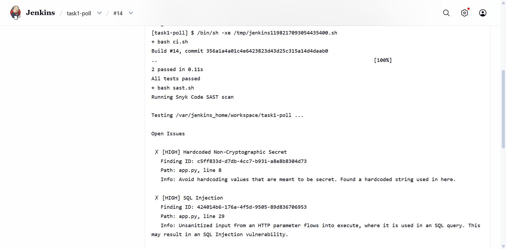

**2. The gate failed the build:**

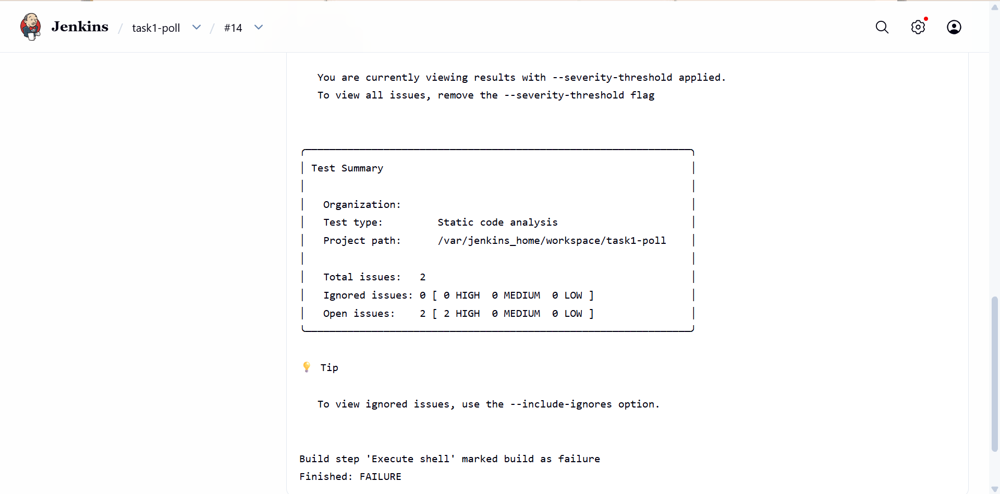

**3. After fixing the code, the scan found 0 issues and the build passed:**


**4. Build history: clean (#13), vulnerable (#14), fixed (#15):**


This is the point of shift-left security: the tests said the code *works*, only the SAST stage said it was *unsafe*, and it was stopped before it could ever be deployed.

**Fail closed:** during a Snyk maintenance window the scan couldn't run, and the build failed instead of passing. For a security gate that's the right behaviour, since a scan that didn't run shouldn't count as a pass.

### AI Edge: analyzing a finding and fixing it

**Finding:** `[HIGH] SQL Injection`, `app.py` line 29
> Unsanitized input from an HTTP parameter flows into execute, where it is used in an SQL query.

**What was wrong:**

```python
name = request.args.get("name", "")
query = f"SELECT id, name FROM users WHERE name = '{name}'"
rows = conn.execute(query).fetchall()
```

The `name` parameter was pasted straight into the SQL string. A request like `/users?name=' OR '1'='1` turns the query into `... WHERE name = '' OR '1'='1'`, which is always true, so it returns every user. With other inputs an attacker could read other tables or change data.

**Fix: parameterized query**

```python
rows = conn.execute(
    "SELECT id, name FROM users WHERE name = ?", (name,)
).fetchall()
```

The `?` placeholder sends the input to the database separately from the SQL, as plain data. It can never change the structure of the query, so `' OR '1'='1` is just searched for as a (strange) name. Other good habits: validate input, and give the app's database user only the permissions it needs.

**Second finding:** `[HIGH] Hardcoded Non-Cryptographic Secret`, `app.py` line 8. The Flask secret key was a fixed string in the code, so anyone who could read the repo could forge session cookies. Fixed by reading it from the `SECRET_KEY` environment variable, with a random key generated at startup if it isn't set:

```python
app.config["SECRET_KEY"] = os.environ.get("SECRET_KEY") or secrets.token_hex(32)
```

In production the real key would come from a secret manager such as AWS Secrets Manager, and a secret that was ever committed should be rotated, since it stays in Git history.

---

## Task 3: Docker Image CI/CD to ECR

**Goal:** Build a Docker image of the backend app in the pipeline, tag it with the Git commit hash, and push it to Amazon Elastic Container Registry (ECR).

Pipeline now: **poll GitHub → checkout → unit tests → SAST gate → build image → push to ECR**

An image is only built and pushed if the tests and the security scan both pass, so a vulnerable build never reaches the registry.

### The app image

[`Dockerfile`](Dockerfile):

- `python:3.12-slim` base, to keep the image small with fewer packages that could have vulnerabilities
- Served with **gunicorn**, a production server (Flask's built-in server is for development only)
- Runs as a **non-root user** (`appuser`)
- A `HEALTHCHECK` on `/health`, so Docker and ECS can tell when the app is unhealthy
- Test tools are kept out of the image: `requirements.txt` has only runtime packages, `requirements-dev.txt` adds pytest for CI, and [`.dockerignore`](.dockerignore) leaves out tests, docs and `.git`

### How Jenkins builds and pushes

- **Docker CLI** is added to the Jenkins image ([`jenkins/Dockerfile`](jenkins/Dockerfile)), and [`jenkins/run.sh`](jenkins/run.sh) mounts the host's `/var/run/docker.sock`. Jenkins sends build commands to the EC2 host's Docker, so it doesn't run its own Docker daemon.
- **AWS CLI v2** is added to the Jenkins image to get the ECR login token.
- **No AWS access keys anywhere.** The EC2 instance has an IAM role (`barakah-jenkins-ec2-role`), and AWS hands out short-lived credentials that rotate on their own. The instance metadata hop limit is set to 2 so the Jenkins container can reach them, with IMDSv2 required.
- **Least privilege:** the role's policy only allows `ecr:GetAuthorizationToken` plus the push actions on the `barakah-app` repository. It can't touch anything else in the account.

[`push-ecr.sh`](push-ecr.sh) does the work:

1. Looks up the account ID from the role, so nothing is hardcoded
2. Tags the image with the short Git commit hash (`git rev-parse --short=7 HEAD`)
3. Skips the push if that tag is already in ECR
4. Builds the image, logs in to ECR, and pushes it
5. Logs out and deletes the local image, so no login token stays on disk and old images don't fill up the instance

### ECR repository settings

- **Private** repository `barakah-app` in `us-east-1`
- **Immutable tags:** a tag like `0db5fb6` always points to exactly that commit and can't be overwritten. That's also why the script checks for an existing tag first, so running the pipeline again on the same commit doesn't fail.

### Proof it works

**1. After tests and SAST pass, the image is built and tagged with the commit hash:**

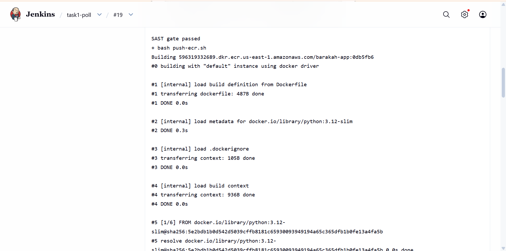

**2. The image is pushed to ECR, then the login and local image are cleaned up:**

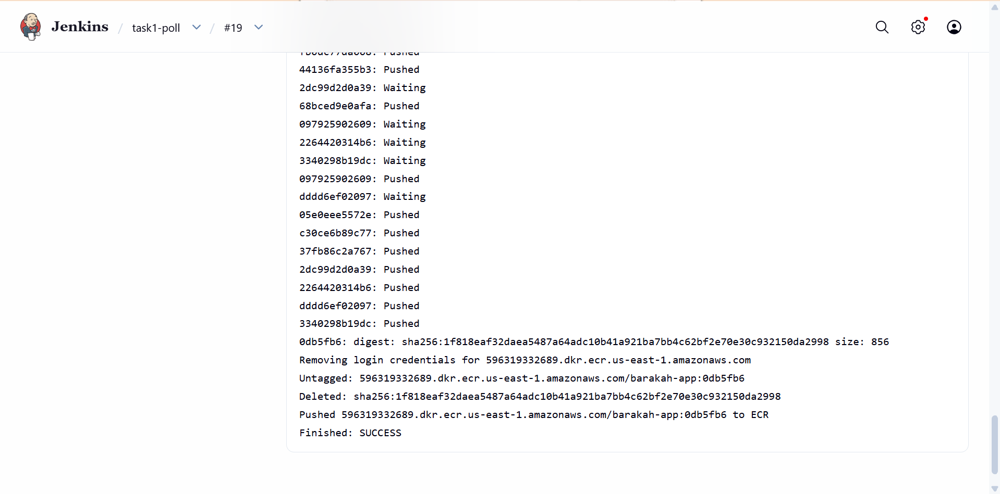

**3. The image in ECR, tagged `0db5fb6`, the same as commit [`0db5fb6`](https://github.com/arsalqazi3/Barakah-DevOps-Internship/commit/0db5fb660ab9370d0ae56e529888ef1016c8d001):**

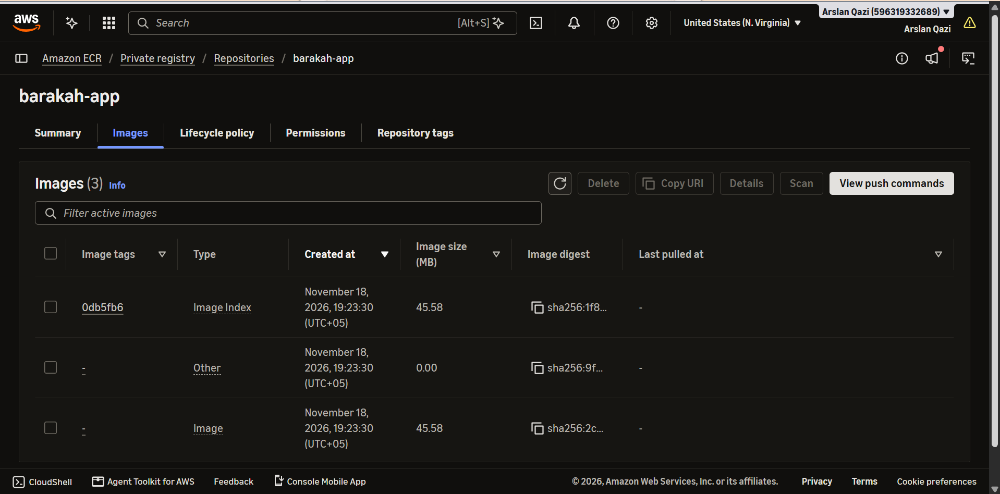

The two untagged entries next to it are normal. Docker's BuildKit pushes an **image index** that points to the real **image** plus a small **attestation** (build provenance record). Only the index carries the tag.

### Trade-offs

- **Docker socket access** is basically root on the host. It's acceptable here because only my IP can reach Jenkins, but bigger setups use separate build agents or rootless builders like Kaniko or Buildah.
- **Login token on disk:** `docker login` writes the ECR token to `~/.docker/config.json` unencrypted. The script logs out right after the push, and the token expires after 12 hours anyway. A credential helper like `amazon-ecr-credential-helper` would avoid writing it at all.

### AI Edge: authenticating Docker to ECR with the AWS CLI

ECR doesn't use a fixed username and password. You ask AWS for a temporary token, which lasts 12 hours, and hand it to Docker:

```bash
# 1. Find the account ID (works with any credentials, including an EC2 role)
ACCOUNT_ID=$(aws sts get-caller-identity --query Account --output text)
REGISTRY="$ACCOUNT_ID.dkr.ecr.us-east-1.amazonaws.com"

# 2. Get a token and log Docker in. The username is always "AWS".
aws ecr get-login-password --region us-east-1 \
  | docker login --username AWS --password-stdin "$REGISTRY"

# 3. Tag and push
docker tag barakah-app:latest "$REGISTRY/barakah-app:<commit-hash>"
docker push "$REGISTRY/barakah-app:<commit-hash>"

# 4. Clean up the stored login
docker logout "$REGISTRY"
```

- `--password-stdin` pipes the token in, so it never shows up in the process list or shell history.
- The caller needs `ecr:GetAuthorizationToken` for the login, plus push permissions on the repository.
- The old `aws ecr get-login` command from AWS CLI v1 has been removed. `get-login-password` is the current way.

---

## Task 6: Automated Container Deployment to ECS

**Goal:** Extend the ECR pipeline so that once a new image is pushed, it automatically updates the Amazon ECS task definition and forces a rolling update of the running app.

Pipeline now: **poll GitHub → checkout → unit tests → SAST gate → build and push image to ECR → register new task definition → rolling update on ECS**

One `git push` to `main` takes new code all the way to a running container, with no manual steps.

### ECS setup

- **Cluster** `barakah-cluster` running on **Fargate**, so AWS runs the containers and there are no extra servers to manage
- **Service** `barakah-app-svc` keeps 1 task running (0.25 vCPU, 512 MB)
- **Task definition** `barakah-app`, kept in the repo as [`ecs/task-definition.json`](ecs/task-definition.json):
  - pulls the image from ECR using the `ecsTaskExecutionRole` (managed policy `AmazonECSTaskExecutionRolePolicy`)
  - sends logs to CloudWatch (`/ecs/barakah-app`, kept 7 days)
  - has a container health check on `/health`
  - sets `APP_VERSION` to the commit hash, which `/health` returns, so you can see which version is live
- **Network:** the task gets a public IP, and its security group only allows port 8000 from my IP. There's no load balancer, to keep costs down.

### Rolling update settings

- **`minimumHealthyPercent=100`, `maximumPercent=200`:** ECS starts the new task first, waits until it's healthy, and only then stops the old one. The app is never down during a deploy.
- **Deployment circuit breaker with rollback:** if the new version keeps failing its health check, ECS stops the rollout and goes back to the last working revision on its own.

### How the pipeline deploys

[`deploy-ecs.sh`](deploy-ecs.sh) runs after the image is pushed:

1. Builds the image URI with the same commit hash tag as Task 3
2. Runs [`ecs/render_taskdef.py`](ecs/render_taskdef.py) to put that image URI and `APP_VERSION` into a copy of the task definition JSON
3. Registers it as a new revision (`barakah-app:1` → `barakah-app:2` → ...)
4. Calls `update-service` with the new revision, which starts the rolling update
5. Waits for the service to become stable
6. Checks that the service is really running the **new** revision. If the circuit breaker rolled back, the service is stable but on the old revision, so the script fails the build instead of reporting a false success.

**Permissions:** the Jenkins EC2 role got a second inline policy, `ecs-deploy-barakah-app`. It can register task definitions, update and describe only the `barakah-app-svc` service, and pass only `ecsTaskExecutionRole`, and only to ECS tasks (`iam:PassedToService`). That condition blocks a common privilege escalation where a role passes a more powerful role to some other service.

### Proof it works

**1. Before: the first version, deployed by hand, with no version field yet:**

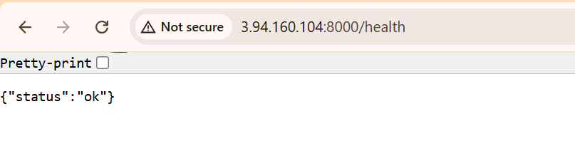

**2. A push to `main` ran the whole pipeline, registered `barakah-app:2` and rolled it out:**

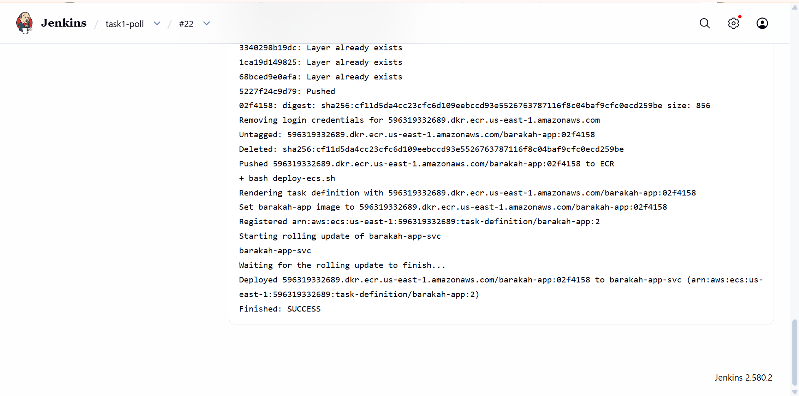

**3. ECS shows the deployment as successful, with 0 failed tasks for the circuit breaker:**

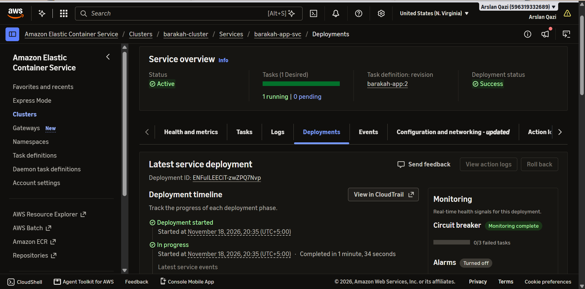

**4. Service events show the rolling update: the new task started (20:35), then the old task stopped (20:36), then the service reached a steady state (20:38):**

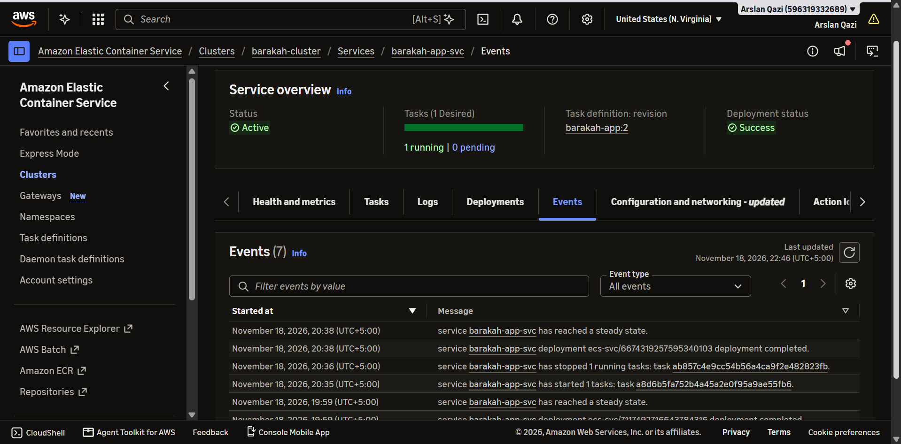

**5. Each deploy creates a new task definition revision:**

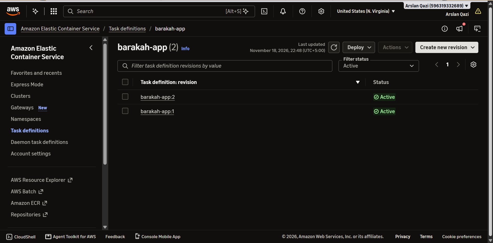

**6. After: the live app returns the new commit hash:**

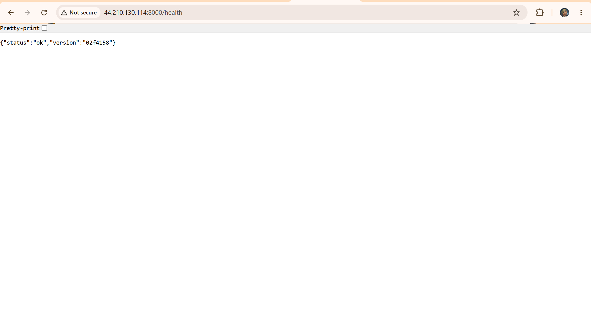

### Cost control

When I'm not demoing, the service is scaled to 0 tasks, so nothing runs and nothing is billed for Fargate:

```bash
aws ecs update-service --cluster barakah-cluster --service barakah-app-svc --desired-count 0
```

Set it back to `1` to bring the app up again.

### AI Edge: a script that updates the image URI in a task definition JSON

[`ecs/render_taskdef.py`](ecs/render_taskdef.py) takes a task definition JSON file, a container name and a new image URI, and writes an updated copy:

```bash
python3 ecs/render_taskdef.py ecs/task-definition.json taskdef-rendered.json \
  barakah-app 596319332689.dkr.ecr.us-east-1.amazonaws.com/barakah-app:02f4158
```

What it does:

- Finds the container by **name**, not by position, so it still works if the task gets a sidecar container later
- Replaces its `image` and sets `APP_VERSION` to the tag
- Removes read-only fields that AWS adds (`taskDefinitionArn`, `revision`, `status`, `registeredAt` and so on). This means it also works on JSON from `aws ecs describe-task-definition`, which otherwise can't be registered again as-is.
- Fails loudly if the container name isn't found, so a typo can't silently deploy nothing

Keeping the task definition in Git means every change to CPU, memory, ports or environment is reviewed and versioned like code, and the pipeline only ever changes the image.
