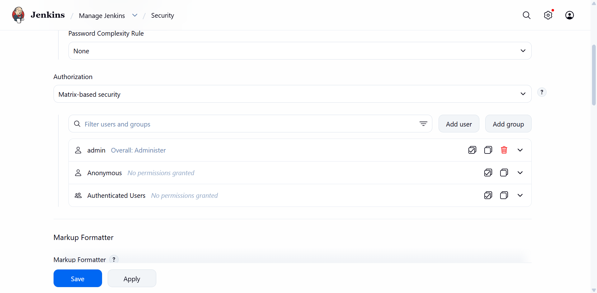
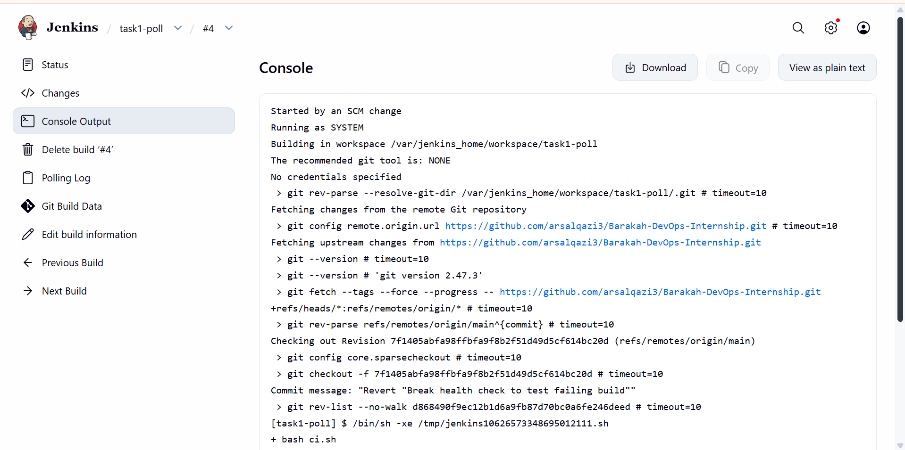
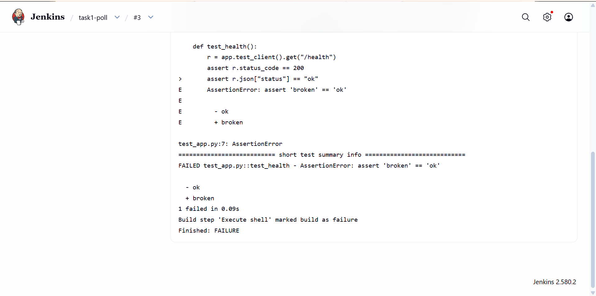
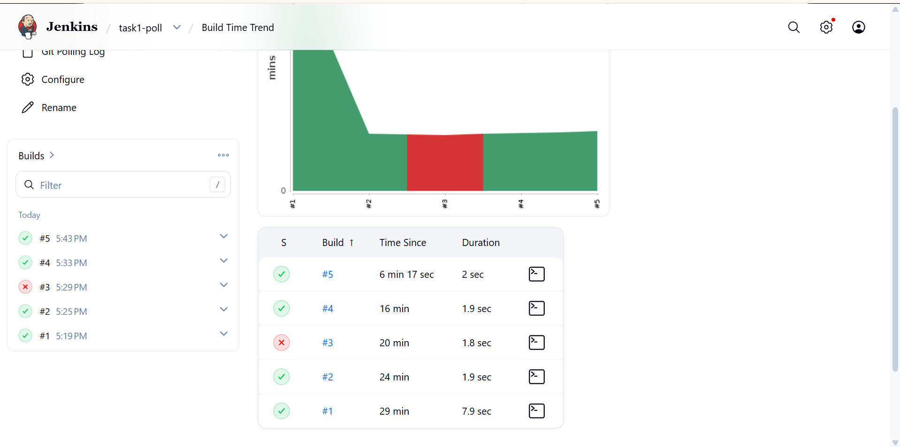

# Barakah TechLabs DevOps Internship

AWS DevOps & CI/CD Pipeline Engineer internship tasks by Arslan Asad Qazi.

All tasks build on one small Flask app, so each task adds a new stage to the same pipeline.

| Task | Tag |
|---|---|
| Task 1: Jenkins Server Setup via Docker | `task-1-jenkins` |

---

## Task 1: Jenkins Server Setup via Docker

**Goal:** Run Jenkins in Docker, install plugins, secure the admin panel, and create a Freestyle job that runs a shell script when it polls the repo and finds a new commit.

### Setup

- **Host:** AWS EC2, Ubuntu 24.04
- **Jenkins:** official `jenkins/jenkins:lts-jdk21` image, extended with Python in [`jenkins/Dockerfile`](jenkins/Dockerfile)
- **Run script:** [`jenkins/run.sh`](jenkins/run.sh) builds the image and starts the container with a restart policy and a named volume, so jobs and settings survive restarts
- **Java 21:** Jenkins LTS dropped Java 17 in 2026, so the JDK 21 image keeps Jenkins on a supported, patched version

To run it on a fresh Docker host:

```bash
git clone https://github.com/arsalqazi3/Barakah-DevOps-Internship.git
cd Barakah-DevOps-Internship
bash jenkins/run.sh
```

### Plugins

Installed the suggested plugins from the setup wizard, mainly Git (to pull the repo), Credentials and Matrix Authorization Strategy (for permissions). All plugins were updated after setup.


### Securing the admin panel

Jenkins can run any code on its server, so an open Jenkins is a common target. I used several layers:

- **Network:** the EC2 security group only allows port 8080 and SSH from my own IP. The rest of the internet can't reach Jenkins at all.
- **No public sign-up:** "Allow users to sign up" is turned off.
- **Matrix-based security:** only my admin account has permissions. Anonymous users get nothing, so they only see the login page.
- **Custom admin username:** not the default `admin`.
- **Agent port disabled:** no inbound agents are used, so that port stays closed.
- **CSRF protection:** left on (default).




**Known trade-off:** Jenkins runs on plain HTTP here, so the login isn't encrypted in transit. For production I'd put it behind HTTPS (a reverse proxy with a certificate) or reach it only through an SSH tunnel.

### Freestyle job with Poll SCM

Job `task-1-poll`:

- **Source:** this repo, branch `main`
- **Trigger:** Poll SCM, schedule `H/2 * * * *` (checks for new commits every 2 minutes)
- **Build step:** `bash ci.sh`

[`ci.sh`](ci.sh) creates a clean Python environment, installs the requirements and runs the unit tests. It uses `set -euo pipefail`, so any failing test fails the build.

The job's config is saved in [`jenkins/jobs/task-1-poll/config.xml`](jenkins/jobs/task-1-poll/config.xml), so it can be reviewed and recreated.

### Proof it works

**1. A push starts a build by itself:**




**2. A broken test fails the build:**



**3. Reverting the change makes it pass again:**



### Why polling and not a webhook?

The task asks for a repository poll. Polling also works without opening Jenkins to GitHub, since Jenkins reaches out and nothing has to come in. In production, a webhook is usually better because it reacts at once and doesn't keep asking GitHub.

### AI Edge: declarative vs scripted pipelines

Both are written in a `Jenkinsfile` kept in the repo (pipeline as code). Freestyle jobs like this one are set up by clicking in the UI instead, which is why they're seen as legacy.

- **Declarative:** a fixed structure, `pipeline { agent ... stages { stage(...) { steps { ... } } } }`. Jenkins checks the syntax before running, and it has built-in blocks like `post`, `options` and `when`. Easy to read and the usual choice today.
- **Scripted:** plain Groovy inside `node { stage(...) { ... } }`. It allows full programming logic like loops and complex conditions, but it's harder to read and easier to get wrong.

Short version: declarative for most pipelines, scripted only when you need logic the declarative format can't express (and even then, a `script { }` block inside a declarative pipeline is often enough).